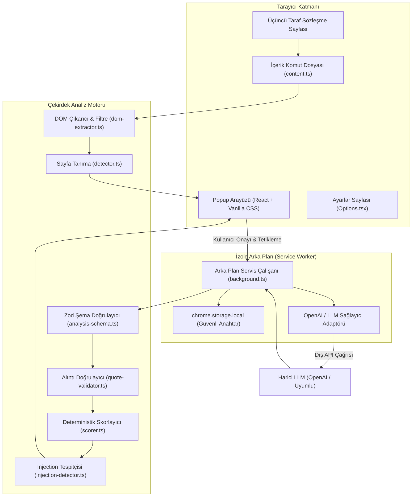

# ŞartMercek — Türkçe Sözleşme Risk Analizcisi

[](https://vitest.dev/)
[](https://www.cypress.io/)
[](https://developer.chrome.com/docs/extensions/mv3/intro/)
[](https://www.typescriptlang.org/)
[](./LICENSE)

**ŞartMercek**, kullanıcıların ziyaret ettiği internet sitelerindeki kullanım koşulları (Terms of Service), gizlilik politikaları (Privacy Policy), KVKK aydınlatma metinleri ve abonelik şartlarını DOM üzerinden pasif olarak okuyan, yapay zekâ destekli analiz eden ve **kaynak metinden doğrulanmış alıntılarla** yapılandırılmış risk raporu sunan açık kaynaklı bir Chrome Manifest V3 uzantısıdır.

---

> [!IMPORTANT]
> **Hukuki Tavsiye Uyarısı:**  
> **Bu araç hukuki tavsiye vermez. Analiz otomatik olarak hazırlanır, hata veya eksik içerebilir. Önemli kararlar için sözleşmenin tamamını inceleyin ve gerektiğinde bir hukuk uzmanına danışın.**

---

## 1. Projenin Amacı ve Özellikleri

İnternet kullanıcıları ve tüketiciler, uzun ve karmaşık hukuki metinleri okumakta zorlanmakta; otomatik yenilenen abonelikler, tek taraflı fiyat artışları, verilerin üçüncü taraflarla paylaşılması ve cezai şartlar gibi kritik riskleri fark edememektedir.

ŞartMercek bu sorunu **kanıta dayalı ve deterministik** bir yaklaşımla çözer:
- **Akıllı Sayfa Tanıma:** URL kalıpları, HTML başlıkları ve hukuki kavram sıklığını birlikte değerlendirerek sözleşme türünü tespit eder; belirsiz sayfalarda kullanıcıyı açıkça uyarır.
- **Güvenli ve Pasif DOM Okuma:** Menü, footer, reklam, gizli metin (`display:none`) ve betikleri (`<script>`) ayıklar; yalnızca görünür sözleşme metnini yakalar.
- **Alıntı Doğrulaması (Quote Verification):** Modelin bulduğu her riskli madde için sunduğu alıntı, kaynak metinde alt dize (substring) olarak deterministik kodla doğrulanır. Uydurulmuş veya değiştirilmiş alıntılar derhal elenir.
- **Deterministik Risk Skoru:** 0–100 arasındaki risk skoru LLM'nin tahminine bırakılmaz; doğrulanmış maddelerin önem ağırlıkları üzerinden şeffaf bir formülle hesaplanır.
- **Kendi Anahtarını Kullan (BYOK):** Kullanıcı kendi OpenAI veya OpenAI-uyumlu (Groq, OpenRouter, yerel vLLM/Ollama) API anahtarını kullanır. Anahtar yalnızca cihazın yerel depolama alanında tutulur.
- **Prompt Injection Savunması:** Gizli ve görünür komut enjeksiyonlarına karşı yapısal sınırlar ve otomatik güvenlik uyarıları içerir.

---

## 2. Çalışan Özellikler ve Bilinen Sınırlamalar

### ✅ Çalışan Özellikler
1. **Chrome Extension Manifest V3 Derlemesi:** Arka plan servis çalışanı, içerik komut dosyası, popup ve seçenekler sayfaları eksiksiz derlenir (`npm run build`).
2. **DOM Çıkarımı & Hash Alma:** Temizlenmiş sözleşme metni, SHA-256 içerik hash'i ve karakter sayımıyla çıkarılır.
3. **10 Standart Hukuki Risk Kategorisi:** Otomatik yenileme, fiyat değişiklikleri, veri paylaşımı, içerik lisansı, fesih vb.
4. **Alıntı Doğrulayıcı:** Kaynakta birebir bulunmayan hiçbir iddia rapora giremez; reddedilen iddiaların sayısı raporlanır.
5. **Kullanıcı Onayı Mekanizması:** Kullanıcı onay kutusunu işaretlemeden metin harici LLM sağlayıcısına gönderilmez.
6. **Güvenlik Savunma Testleri (Test A-E):** Gizli talimat, görünür talimat, sahte alıntı, JSON saldırısı ve aşırı uzun doküman testleri otomatize edilmiştir.
7. **5 Gerçek Hizmetli Mini Eval:** Spotify, Discord, Notion, Trendyol ve Getir resmî sözleşme kesitleriyle referans veri kümesi ve doğrulama altyapısı mevcuttur.
8. **Cypress E2E Video Kaydı:** Mutlu yol ve dürüst belirsizlik anlarını içeren gerçek E2E video kaydı üretilmiştir.

### ⚠️ Bilinen Sınırlamalar
- **Canvas / Resim İçi Sözleşmeler:** Sayfa sözleşmeyi metin yerine taranmış bir PDF veya resim (image) olarak sunuyorsa OCR yapılmaz; metin yetersizliği uyarısı verilir.
- **Dinamik Sonsuz Kaydırma:** Sözleşme kullanıcı kaydırdıkça parça parça yüklenen bir arayüze sahipse, o an DOM'da yüklü olan görünür kısım analiz edilir.
- **Yerel Depolama Sınırı:** API anahtarı `chrome.storage.local` üzerinde saklandığından, tarayıcı profili sıfırlandığında anahtarın tekrar girilmesi gerekir.

---

## 3. Kullanılan Teknolojiler

- **Çekirdek:** TypeScript 5.6, React 18
- **Uzantı Çerçevesi:** WXT (Vite 6 tabanlı Manifest V3 mimarisi)
- **Stil & Arayüz:** Vanilla CSS (Erişilebilir, modern karanlık tema, özel CSS değişkenleri)
- **Çalışma Zamanı Doğrulama:** Zod 3.23 (Tip güvenli JSON şeması)
- **GUI Ajanı İncelemesi:** `@page-agent/core@1.12.4` (Salt okunur ve güvenlik değerlendirmesi)
- **Birim ve Entegrasyon Testleri:** Vitest 2.1 & JSDOM
- **E2E Test & Video Kaydı:** Cypress 13.17

---

## 4. Mimari Diyagram



---

## 5. Veri Akışı

```
Chrome Sayfası
      │
      ▼
DOM Metin Çıkarımı (script, style, display:none ayıklanır)
      │
      ▼
Sayfa Türü ve Kapsam Kontrolü (URL, başlık, hukuki kavram sıklığı)
      │
      ▼
Kullanıcının Analiz Onayı ("Metni Analiz Et" butonu)
      │
      ▼
Arka Plan Servis Çalışanı (İzole ortamda LLM API çağrısı)
      │
      ▼
JSON Ayrıştırma ve Zod Şema Doğrulaması
      │
      ▼
Deterministik Alıntı Doğrulaması (Kaynakta birebir bulunmayan alıntılar elenir)
      │
      ▼
Deterministik Risk Skoru Hesaplama (Doğrulanmış maddelerin ağırlıkları toplanır)
      │
      ▼
Türkçe Risk Raporu (Kanıtlar, etki analizi, kontrol önerileri ve yasal uyarı)
```

---

## 6. Page-Agent'in Mimarideki Rolü

Projede `@page-agent/core@1.12.4` resmi kütüphanesi mimari ve güvenlik açılarından değerlendirilmiştir (`src/core/extraction/page-agent-evaluator.ts`).

- **Değerlendirme Sonucu:** Page-Agent, sayfada aktif tıklamalar, form doldurmalar ve gezintiler gerçekleştiren bir GUI otomasyon ajanıdır. Üçüncü taraf sözleşme sayfalarında aktif `execute()` çağrısı yapılması, saldırgan sözleşme metinlerindeki prompt injection yönlendirmeleriyle ajanın istemsizce *"Şartları Kabul Et"* butonuna tıklaması riskini doğurur. Ayrıca sayfa bağlamında API anahtarı ifşa riski bulunur.
- **Güvenli Sınır Tercihi:** ŞartMercek, sözleşme okuma işlemini doğrudan kendi pasif, salt okunur ve temizleyici `dom-extractor.ts` modülüyle yapar. Tüm LLM çağrıları arka plan servis çalışanına izole edilmiştir.

---

## 7. Güvenlik Modeli ve Prompt Injection Savunması

Sözleşme sayfaları kötü niyetli talimatlar barındırabilir. ŞartMercek şu çok katmanlı savunmayı uygular:
1. **display:none ve Gizli İçerik Filtresi:** CSS ile saklanan hiçbir talimat analiz kapsamına alınmaz.
2. **Yapısal Sınırlandırma:** Sözleşme metni LLM'ye `<untrusted_contract_text>` etiketleriyle iletilir; sistem promptunda metin içindeki talimatların kesinlikle emir sayılamayacağı bildirilir.
3. **Alıntı Doğrulama Zorunluluğu:** Saldırgan metin modeli kandırsa dahi, kaynak metinde birebir bulunmayan veya bağlamı çarpıtılmış maddeler kod düzeyinde reddedilir.
4. **Şüpheli Kalıp Tespiti:** Enjeksiyon girişimleri tespit edildiğinde raporda ayrı kırmızı güvenlik paneli açılır.

Detaylı güvenlik analizi ve tehdit modeli için [docs/SECURITY.md](./docs/SECURITY.md) dosyasını inceleyiniz.

---

## 8. Alıntı Doğrulamasının Nasıl Çalıştığı

Her risk iddiası (`finding`) kaynak metinden gerçek bir alıntı (`quote`) içermek zorundadır:
1. Alıntı metni baştan ve sondan kırpılır (trim).
2. Kaynak metin içinde tam alt dize (verbatim substring) araması yapılır.
3. Satır sonu ve boşluk farkları için beyaz boşluk normalizasyonu (`normalizeWhitespace`) uygulanır.
4. Kaynakta bulunamayan, uydurulmuş (hallucinated) veya anlamı değiştirilerek yazılmış (paraphrased) alıntılar **reddedilir**.
5. Geçersiz alıntı sayısı kaydedilir; ancak hassas veya gizli metinler loglara yazılmaz.

---

## 9. Risk Skorunun Nasıl Hesaplandığı

Nihai risk skoru LLM'nin önerisine dayanmaz; **yalnızca kaynakta alıntısı doğrulanmış** geçerli bulguların önem seviyeleri üzerinden deterministik olarak hesaplanır:

$$\text{Ham Skor} = \sum (\text{Doğrulanmış Madde Ağırlığı})$$

| Seviye | Ağırlık | Açıklama |
|---|---|---|
| **critical** | 25 puan | Fesih hakkı kısıtlaması, habersiz tahsilat |
| **high** | 15 puan | Tek taraflı değişiklik, otomatik yenileme |
| **medium** | 8 puan | Sorumluluk muafiyeti, veri aktarımı |
| **low** | 3 puan | Diğer tüketici maddeleri |

$$\text{Nihai Skor} = \min(100, \max(0, \text{Ham Skor}))$$

- **0 – 20:** Düşük Risk
- **21 – 50:** Orta Risk
- **51 – 75:** Yüksek Risk
- **76 – 100:** Kritik Risk

---

## 10. LLM API Anahtarını Yapılandırma

1. Uzantı simgesine tıklayın ve **"Ayarlar"** sekmesini açın (veya uzantıya sağ tıklayıp *Seçenekler* deyin).
2. Sağlayıcı türünü seçin:
   - **OpenAI (Resmî):** Base URL: `https://api.openai.com/v1`, Model: `gpt-4o-mini`
   - **Özel OpenAI-Uyumlu:** Groq, OpenRouter veya yerel endpoint (`http://localhost:11434/v1`)
3. API anahtarınızı girin.
4. **"🔌 Bağlantıyı Test Et"** butonuna basarak doğruluğunu kontrol edin.
5. **"💾 Ayarları Kaydet"** butonuna tıklayın.

---

## 11. Kurulum ve Gereksinimler

- Node.js v20+ (Node v24 test edilmiştir)
- npm v10+

```bash
# Depoyu klonlayın ve klasöre girin
cd sart_mercek

# Bağımlılıkları yükleyin
npm install
```

---

## 12. Geliştirme Sunucusunu Çalıştırma

```bash
# Uzantı geliştirme modu (WXT dev server)
npm run dev

# E2E test ve interaktif demo ortamı
npm run preview
```

---

## 13. Chrome Uzantısını Yükleme Adımları

1. Projeyi derleyin:
   ```bash
   npm run build
   ```
2. Çıktı klasörü oluşacaktır: `.output/chrome-mv3`
3. Google Chrome tarayıcısını açın ve adres çubuğuna şunu yazın:
   ```text
   chrome://extensions/
   ```
4. Sağ üst köşedeki **"Geliştirici modu" (Developer mode)** anahtarını açın.
5. Sol üstteki **"Paketlenmemiş öğe yükle" (Load unpacked)** butonuna tıklayın.
6. Proje dizinindeki `.output/chrome-mv3` klasörünü seçin.
7. ŞartMercek uzantısı araç çubuğunuza eklenecektir!

---

## 14. Testleri Çalıştırma

### Birim ve Güvenlik Testleri (Vitest)
Tüm alıntı doğrulama, risk skorlama, DOM çıkarma ve zorunlu güvenlik saldırı testlerini çalıştırır:
```bash
npm test
```
*Sonuç: 5 test dosyası, 26 testin tamamı başarılı (passing).*

### E2E Testleri ve Video Kaydı (Cypress)
```bash
npm run cypress:run
```
*Sonuç: 2 E2E senaryosu başarılı, Cypress video çıktısı üretilir.*

---

## 15. Mini Eval Sonuçları

`eval/` dizininde 5 gerçek resmî Türkçe sözleşme kesiti (Spotify, Discord, Notion, Trendyol, Getir) ve 13 insan referans etiketi (ground-truth) bulunmaktadır.

Çalıştırma komutu:
```bash
npm run eval
```

### Değerlendirme Çıktısı:
- **Referans Veri Kümesi Bütünlüğü:** 13/13 referans alıntının tamamı kaynak metinlerde doğrulanmıştır (%100).
- **Canlı LLM Değerlendirme Durumu:** Ortam değişkeninde `OPENAI_API_KEY` tanımlanmadığı durumlarda sistem sahte metrik üretmez; durumu `NOT RUN` olarak raporlar (`eval/results/eval-report.md`).
- **Canlı Çalıştırma:**
  ```powershell
  $env:OPENAI_API_KEY = "sk-..."
  npm run eval
  ```

---

## 16. Cypress Demo Videosunun Konumu

Cypress E2E testleri tarafından kaydedilen gerçek demo videosu:
- **Konum:** `cypress/videos/demo.cy.ts.mp4`
- **Dosya Boyutu:** ~122 KB
- **Süre:** ~4-5 saniye (90 saniye sınırının oldukça altında)
- **Kapsanan Anlar:**
  1. *Mutlu Yol:* Spotify sözleşmesi tespiti, kullanıcı onayı, analiz tetikleme, 45 puanlık risk skoru ve 3 doğrulanmış alıntılı madde.
  2. *Dürüst Belirsizlik Anı:* Düşük güvenli (< %45) sayfa uyarısı, kısmi kapsam (%35) ve belirsizliğin şeffaf şekilde raporlanması.

---

## 17. Bilinen Sorunlar ve Çözümleri

| Sorun | Neden | Çözüm |
|---|---|---|
| *"API anahtarı bulunamadı"* | Ayarlar henüz yapılmamış | Ayarlar sekmesinden OpenAI API anahtarı ekleyin. |
| *"Bu sayfanın bir sözleşme sayfası olduğundan emin değiliz"* | Sayfa başlığı veya URL'de hukuki terim azlığı | Sayfada metin varsa "Metni Analiz Et" butonuyla yine de incelenebilir. |
| *"Model yanıtı zaman aşımına uğradı"* | Sağlayıcı endpoint yanıt vermedi (45 sn) | İnternet bağlantısını ve Base URL adresini kontrol edin. |

---

## 18. Hukuki Tavsiye Uyarısı

**Bu araç hukuki tavsiye vermez. Analiz otomatik olarak hazırlanır, hata veya eksik içerebilir. Önemli kararlar için sözleşmenin tamamını inceleyin ve gerektiğinde bir hukuk uzmanına danışın.**
