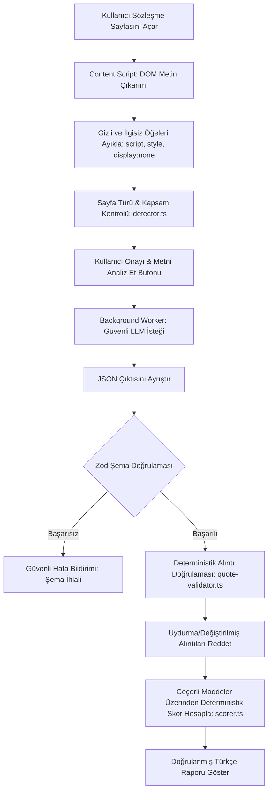

# ŞartMercek — Mimari ve Tasarım Dokümanı (ARCHITECTURE.md)

Bu doküman, **ŞartMercek — Türkçe Sözleşme Risk Analizcisi** projesinin sistem mimarisini, katmanlarını, güvenlik sınırlarını ve veri akışını detaylandırır.

---

## 1. Genel Mimari Bakış

ŞartMercek, Chrome Extension Manifest V3 mimarisi üzerinde TypeScript, React, WXT ve Zod ile geliştirilmiş, **kanıta dayalı ve deterministik** bir risk analiz platformudur.

Temel tasarım ilkeleri:
1. **Asgari Yetki ve İzolasyon:** API anahtarları asla web sayfasına veya içerik komut dosyasına iletilmez; yalnızca uzantının arka plan servis çalışanı (service worker) katmanında tutulur ve kullanılır.
2. **Kanıta Dayalı Alıntı Doğrulaması:** LLM tarafından üretilen hiçbir riskli madde, kaynak metinde birebir alıntıyla doğrulanmadığı sürece rapora kabul edilmez.
3. **Deterministik Risk Skoru:** Nihai risk skoru LLM'nin sezgisel tahminine bırakılmaz; alıntıları doğrulanmış geçerli maddelerin önem seviyeleri (ağırlıkları) üzerinden matematiksel ve deterministik bir kural ile 0–100 arasında hesaplanır.
4. **Pasif ve Güvenli Okuma:** Üçüncü taraf sözleşme sayfalarında herhangi bir tıklama, form doldurma veya otomatik gezinti eylemi yürütülmez.

---

## 2. Mimari Katmanlar

```
┌─────────────────────────────────────────────────────────────────────────────┐
│                            KULLANICI ARAYÜZÜ (UI)                           │
│  - Popup (App.tsx): Analiz Tetikleme, Skor Kartı, Doğrulanmış Maddeler       │
│  - Options (Options.tsx): Kendi API Anahtarını Yönetme & Bağlantı Testi     │
│  - Sabit Hukuki Tavsiye Uyarısı & Güvenlik Bildirimleri                     │
└──────────────────────────────────────┬──────────────────────────────────────┘
                                       │ chrome.runtime.sendMessage
                                       ▼
┌─────────────────────────────────────────────────────────────────────────────┐
│                     ARKA PLAN KATMANI (Background Worker)                   │
│  - Güvenli chrome.storage.local Anahtar Saklama                             │
│  - OpenAI / Uyumlu LLM Sağlayıcı Adaptörü                                   │
│  - Hata Sınıflandırma (Quota, Timeout, Auth, Network)                       │
│  - Hassas Veri Loglama Koruması (Zero-Leakage Policy)                       │
└───────────────┬──────────────────────────────────────────────▲──────────────┘
                │ chrome.tabs.sendMessage                      │ Analiz Talebi
                ▼                                              │
┌───────────────────────────────┐              ┌───────────────┴──────────────┐
│  İÇERİK KOMUT DOSYASI         │              │  ÇEKİRDEK ANALİZ MOTORU      │
│  (Content Script)             │              │  - dom-extractor.ts          │
│  - DOM Okuma & Temizleme      │              │  - detector.ts               │
│  - script/style/hidden ayıklama│              │  - analysis-schema.ts (Zod)  │
│  - Hash & Kapsam Hesaplama    │              │  - quote-validator.ts        │
└───────────────────────────────┘              │  - scorer.ts                 │
                                               │  - injection-detector.ts     │
                                               └──────────────────────────────┘
```

---

## 3. Veri Akışı (Data Flow)

Uygulamanın üretim veri akışı şu sırayla gerçekleşir:



---

## 4. Page-Agent'in Mimarideki Rolü ve Sınırları

Projede resmî `@page-agent/core@1.12.4` paketi mimari ve güvenlik açılarından kapsamlı biçimde değerlendirilmiştir (`src/core/extraction/page-agent-evaluator.ts`).

### Değerlendirme Bulguları:
1. **Eylem Yürütme Riski:** `@page-agent/core`, web sayfalarında görevleri otomatikleştirmek, butonlara tıklamak, form doldurmak ve gezinmek üzere tasarlanmış aktif bir GUI simülasyon ajanıdır. Üçüncü taraf sözleşme sayfalarında `execute()` fonksiyonunun çalıştırılması, sayfadaki prompt injection metinlerinin ajanı yönlendirerek istenmeyen tıklamalar yapmasına ("Şartları Kabul Et" butonuna basılması gibi) yol açabilir.
2. **API Anahtarı Sızıntısı Riski:** PageAgentCore nesnesi oluşturulurken doğrudan web sayfası bağlamına LLM yapılandırması (API anahtarı dahil) istemektedir. Bu durum kullanıcının özel anahtarını üçüncü taraf sayfa kodlarına maruz bırakabilir.
3. **ŞartMercek'in Mimari Tercihi:** ŞartMercek salt okunur (read-only), güvenli ve deterministik bir sözleşme analizcisi olduğundan, DOM metin çıkarımı özel `dom-extractor.ts` modülüyle gerçekleştirilmiş; LLM iletişimi ise tamamen arka plan katmanına izole edilmiştir.

---

## 5. Deterministik Risk Skoru Formülü

Risk skoru LLM'nin verdiği puana göre değil, yalnızca **kaynakta alıntısı doğrulanmış** geçerli bulguların önem seviyeleri üzerinden deterministik olarak hesaplanır:

$$\text{Ham Puan} = \sum (\text{Doğrulanmış Madde Ağırlığı})$$

| Önem Derecesi (Severity) | Puan Ağırlığı |
|---|---|
| **critical** (Kritik) | 25 puan |
| **high** (Yüksek) | 15 puan |
| **medium** (Orta) | 8 puan |
| **low** (Düşük) | 3 puan |

$$\text{Nihai Skor} = \min(100, \max(0, \text{Ham Puan}))$$

### Risk Seviyeleri Eşikleri:
- **0 – 20:** Düşük Risk (low)
- **21 – 50:** Orta Risk (moderate)
- **51 – 75:** Yüksek Risk (high)
- **76 – 100:** Kritik Risk (critical)

Bu skor algoritmik bir sezgisel risk göstergesidir; hukuki kesinlik veya bağlayıcılık taşımaz.
